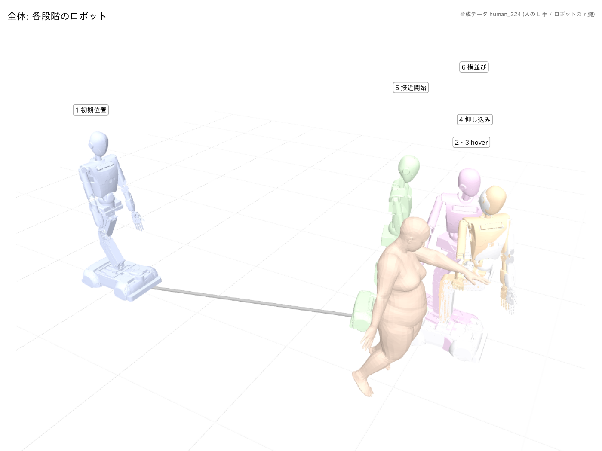
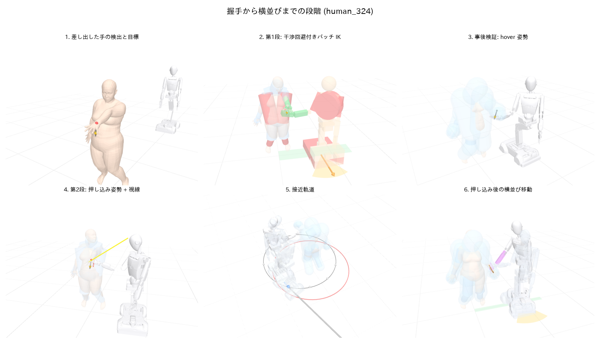
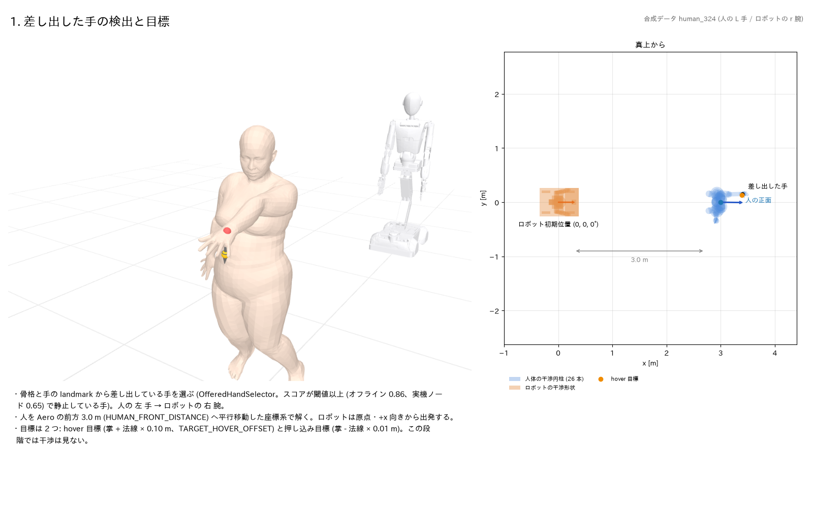
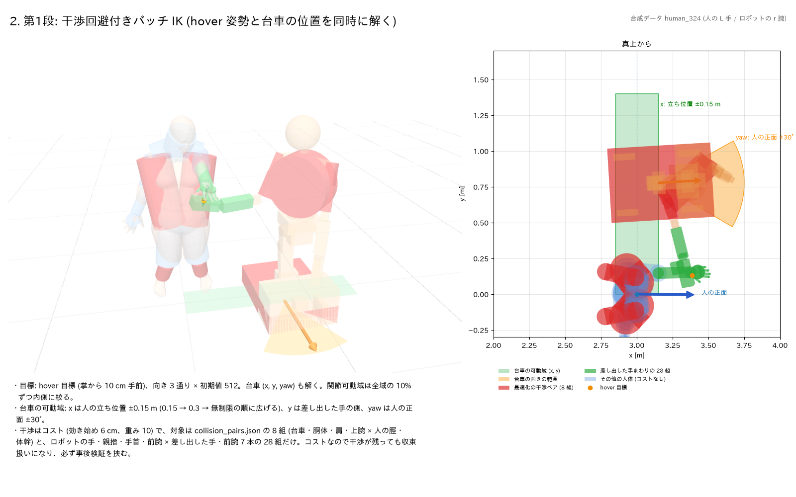
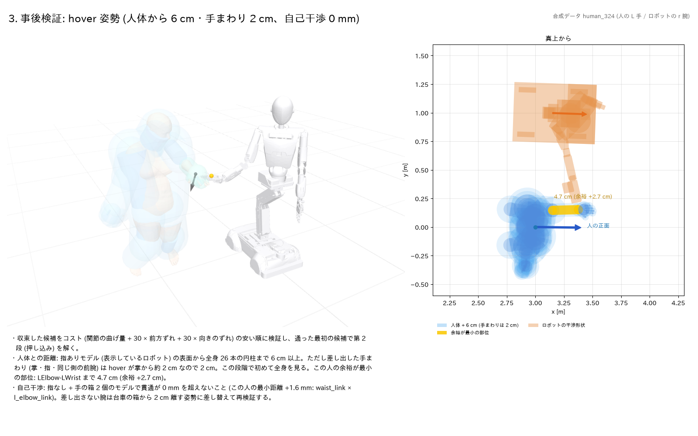
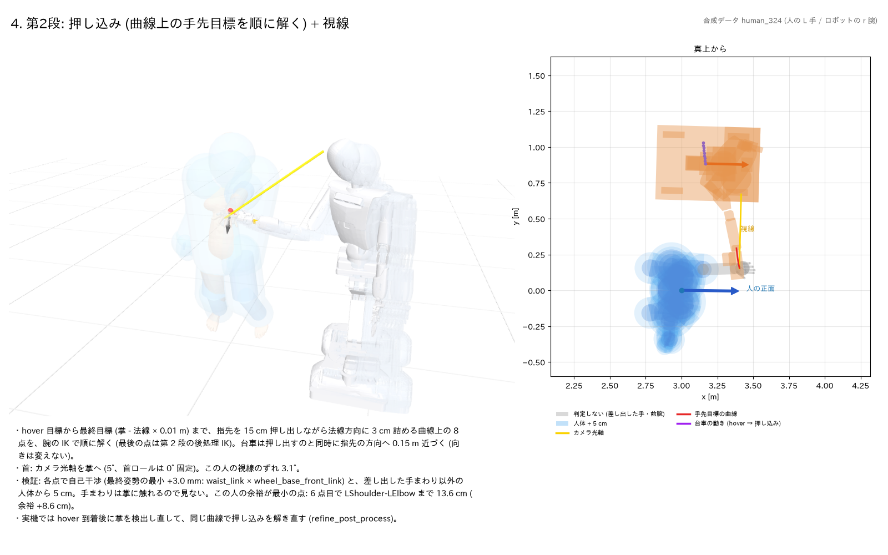
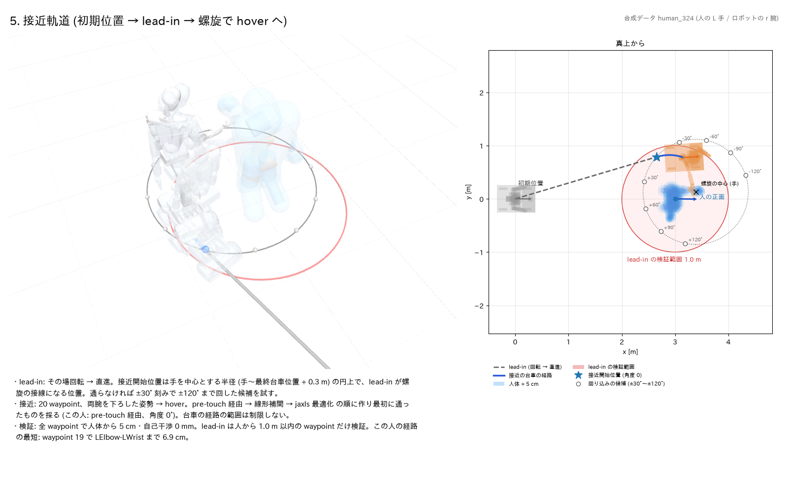
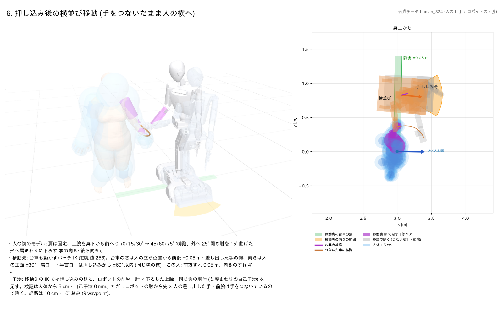

# 握手から横並びまでの段階と、各段階で考慮すること

人が手を差し出してから、ロボットが手を合わせて人と横並びになるまでを 6 つの段階に
分け、それぞれで **何を解き、どの干渉を見て、台車をどこまで動かしてよいか** を図で示す。
値・定数の一覧と根拠は [ik_and_motion_constraints.md](ik_and_motion_constraints.md)
にあり、ここではその見取り図を示す。本文の数値は今のコード (`scripts/*.py` の定数) に合わせてある。

図はすべて合成データ 1 人 (`run_pipeline_test.py 400 --seed 0` の作業ディレクトリのうち
`human_324`: 左手を差し出し、ロボットは右腕で応じる) の実際の計画結果から
[`tools/render_pipeline_stages.py`](dev_tools.md#toolsrender_pipeline_stagespy) で描いた。
各図は、左が 3 次元の描画、右が真上から見た図、下がその人の数値を含む説明。座標は人を
Aero の前方 3.0 m に平行移動した IK・軌道計画の座標系 [m]。コードを変えると人ごとの結果
(台車位置・余裕・waypoint 数など) は変わり、図は以前のコードで描いたものなので、図中の
数値・重み・範囲は本文と食い違うことがある (本文を正とする。作り直し方は末尾)。





## ビューアで見る

同じシーンをブラウザ (viser) で回しながら見られる。

```bash
python3 tools/render_pipeline_stages.py \
    --work-dir /tmp/aero_demo_pipeline_xxxx --name human_324 \
    --viser --no-images
```

- 最初は全段階のロボットを 1 つのシーンに並べた全体表示 (上の図)。**ロボットをクリック
  すると、その段階の詳細** (干渉形状・可動域・経路) に切り替わる。hover の 2・3 は同じ
  姿勢なので 1 体にまとめてあり、クリックで 2 を開く。
- 詳細では、図の各項目 (干渉ペア、人体 + 6 cm、台車の可動域など) を左の
  「表示する項目」の**チェックボックスで表示・非表示**にできる。見出しの色見本がその
  項目の色で、マウスを乗せると説明が出る。
- 「前の段階」「次の段階」「全体に戻る」のボタンと、上の「段階」で切り替える。

## 段階と考慮することの一覧

| 段階 | 解くもの | 台車 | 人体との干渉 | 自己干渉 |
|---|---|---|---|---|
| 1. 差し出した手 | 差し出した手・掌の位置と法線 | 原点 (初期位置) | — | — |
| 2. 第1段 バッチ IK | hover 姿勢 (押し込みの最終目標を法線方向に 4 cm 浮かせ、指先と逆に 15 cm ずらした位置) | x・y・yaw を窓の中で解く | コスト: 8 組 + 差し出した前腕まわり 4 組、6 cm から効く (前腕は 2 cm) | コストなし |
| 3. hover の事後検証 | (検証のみ) | 2 の解のまま | 全身 28 本 (足を含む) から **6 cm**、差し出した手まわりだけ **2 cm** (指ありモデル) | 貫通 0 mm (指なし + 手の箱) |
| 4. 第2段 押し込み + 視線 | hover から指先を 15 cm 押し出しながら 4 cm 詰める曲線上の 8 点 (最後は掌 - 1 cm)・カメラを掌へ | 押し出すのと同時に指先の方向へ近づく (向きは変えない) | 手まわり以外の全身 **5 cm** (手まわりは判定しない) | 貫通 0 mm |
| 5. 接近軌道 | lead-in と 20 waypoint の軌道 | 経路の範囲は制限なし | 全 waypoint で **5 cm**、差し出した手まわりだけ **2 cm** (lead-in は人から 1 m 以内だけ) | 貫通 0 mm |
| 6. 横並び移動 | 移動先 (バッチ IK) と経路 | 移動先は前後 ±0.05 m・手の側・正面 ±45° | **5 cm** (つないだ手・前腕 × ロボットの肘から先は除く) | 貫通 0 mm |

各図の色の意味は図中の凡例に書いてある (ビューアでは項目ごとのチェックボックス)。

## 1. 差し出した手の検出と目標



- 骨格と手の landmark のスコアから、差し出している手を選ぶ (`OfferedHandSelector`)。
  ロボットは差し出した手と反対の腕 (左手なら右腕) で応じる。
- 人を Aero の前方 3.0 m へ平行移動してから解く。ロボットは原点・+x 向きから出発する
  (合成データでは人の向きはランダムで、この人はロボットに背を向けている)。
- 押し込みの**最終目標**は掌 - 法線 × 0.01 m (赤)。**hover 目標** (橙) はそれを掌の法線
  方向に 4 cm (`PRESS_IN_LIFT`) 浮かせ、ロボットの指先 (手先の +Z を掌面へ射影) と逆向きに
  15 cm (`PRESS_IN_SLIDE`) ずらした位置で、向きは最終目標と同じ。hover は人の掌から約
  3 cm しか離れない。押し込みはそこから指先を押し出しながら詰める曲線 (赤線、4 節)。
  この段階では干渉は見ない。

## 2. 第1段: 干渉回避付きバッチ IK



hover 姿勢と台車の位置・向きを同時に解く (向き 3 通り × 初期値 512 を 1 バッチ)。

- **台車の可動域** (緑・橙): x は人の立ち位置 ±0.15 m (解が無ければ ±0.3 m → 無制限)、
  y は差し出した手の側、yaw は人の正面 ±30°。人と横並びに近い位置で握手させるため。
- **干渉はコスト** (人体から 6 cm で効き始める、重み 10):
  - 赤: `collision_pairs.json` の 8 組。ロボットの台車・胴体・肩・上腕 × 人の脛・
    体幹 (左右の肩–腰)。事前の調査で干渉の多かった組だけに絞っている。
  - 緑: ロボットの手・親指の箱・手首・前腕 × 人の差し出した前腕の 4 組。hover が掌から
    約 2 cm なので、前腕の円柱は 2 cm で効くよう (6 cm との差だけ) 細らせて使う。**掌・指は
    組に入れない** (次の事後検証で 2 cm を見る)。
  - それ以外の人体 (青) はこの段階ではコストに入れない。自己干渉もコストに無い。
- コストなので干渉が残っていても収束扱いになる。そのため必ず次の事後検証を挟む。

## 3. 事後検証: hover 姿勢



収束した候補を「関節の曲げ量 + 前方ずれ (重み 30) + 向きのずれ (重み 30) + hover の腰の
沈み込み (`CROUCH_WEIGHT` 300) + 腰の前傾 (`BOW_WEIGHT` 200)」のコストの安い順に検証し、
通った最初の候補で第2段 (押し込み) を解く。沈み込みと前傾は、腰を前に倒すより沈む方を
選ぶ向きに重みを付けた項 (沈んだ腰は押し込み・横並びで浮かせない。
[ik_and_motion_constraints.md](ik_and_motion_constraints.md) の「腰を上げない」)。

- **人体との距離**: 指ありモデルの表面から全身 28 本 (足を含む) の円柱まで **6 cm 以上** (水色の膜の
  外)。ただし**差し出した手まわり (掌・指・同じ側の前腕) だけ 2 cm** (緑の膜。hover が
  掌から約 2 cm のため)。この段階で初めて全身を見る。黄色は余裕 (距離 - 基準) が最小の部位
  (この人は差し出した前腕まで 4.7 cm で、余裕 +2.7 cm)。
- **自己干渉**: 指なし + 手の箱 2 個のモデルで、貫通が 0 mm を超えないこと。
- 差し出さない腕は、手・指先が台車の箱から 2 cm 離れる姿勢に差し替えてから再検証する。

## 4. 第2段: 押し込み (曲線上の手先目標を順に解く) + 視線



hover の解を初期値に、指先を 15 cm 押し出しながら法線方向に 4 cm 詰める曲線 (赤線、
詰めるのは終盤) 上の 8 点を、順に腕の IK で解く。最後の点 (掌 - 1 cm) は後処理 IK で、
腕 (6 自由度) と首 (カメラ光軸を掌へ、黄) を同時に解く。

- **台車は押し出すのと同時に近づく**。各点で、指先方向の押し出しの水平成分だけ hover の
  位置から平行移動する (向きは変えない。紫の点列)。法線方向の詰めは腕が受け持つ。
- **人体との判定**: 各点で、自己干渉と、**差し出した手まわり以外**の全身から **5 cm** (青い
  膜)。手まわり (掌・指・同じ側の前腕、灰) は人の掌に触れるので見ない。
- 首ロールは 0° に固定 (実機の差動アクチュエータの都合)。腕と首を同時に解けなければ、
  腕だけで解いて視線のずれが 15° 未満なら採る。
- 後処理 IK と各点の IK は脚 (足首・膝) も動かして解くので、解いた後に脚のミミック関節を主関節に
  合わせ、脚を固定して腕・腰だけ解き直す (`settle_legs`。しないと実機に送る
  関節角で手先が目標から IK の許容 10 mm を超えて離れる)。
- 実機では接近の開始から MediaPipe Hands で人の手を毎フレーム追跡し (hover では手が
  画像の端で切れやすく、そこから一から検出するのは難しいため)、hover に着いたらその
  結果の掌で同じ曲線の押し込みを解き直す (`refine_post_process`)。計画時の掌から
  0.25 m 以内の手だけを使い、目標の変化が位置 0.25 m・回転 60° (`REFINE_MAX_*`) を
  超えるときは誤検出とみなして補正しない。
- **解き直しでは脚を動かさない** (`REFINE_LEG_STAGES`)。まず脚を固定して腕・腰で解き、
  解けなければ hover の角度から ±8° だけ許し、それでも解けなければ補正しない。脚を自由に
  すると、手のずれを足首で吸収して hover から大きく沈むため (同じ補正量でも脚固定で解ける)。
- **接近中の再照準** (`_retarget_approach`、既定で有効、`--no-approach-retarget` で
  無効)。人が手を出したまま静止していなくてもよいように、到着の 5 秒前
  (それより後に螺旋に入るなら螺旋の開始) から 1.5 秒前まで 0.5 秒ごとに、直近 0.6 秒の
  掌の検出 (4 件以上) の中央値を目標にし、今の目標から 3 cm 以上ずれていれば残りの台車
  軌道をその分平行移動したゴールに置き換える (`in_motion_correction.build_retarget_points`。
  ずらしごとに自分の開始時刻から終点まで滑らかに効かせるので何度でも重ねられる。1 回の
  接近で 4 回まで、計画の掌から 25 cm まで、速さは台車の上限以内、後退は許す。cancel は
  使わない)。腕の軌道は変えない。人体との距離は、差し出した手 (手首・手の点) を検出した
  ずれだけ動かした骨格で見て、通らなければ 1/2・1/4 に縮める (どれも通らなくても、ずらさ
  ないより余裕が増えればその割合)。止まってからの scan 補正の目標も、ずらした掌を計画
  どおりに見る位置にする (ずらしを戻さない)。到着 1 秒前まで追うと近距離の誤検出で悪化し、
  螺旋の開始より前から追うと検出のぶれで行って戻る差し替えが増えるので、この範囲にしている。
  - 検出した掌は、**スキャンを順につないだ照合** (`scan_matching.ScanOdometry`、キーフレーム
    は回転 10°・移動 0.25 m ごとに更新) で区間先頭の台車系に置く。区間先頭のスキャンだけ
    との照合は、180° 近く回った後は重なりが減って通らず、odom は指令の積分で回転中は実機
    より先行するため。押し込み前の scan 補正でも、直接の照合が通らなければこれを使う。
- **押し込み直前の補正で台車を寄せる** (`_shift_base_to_palm`)。hover で検出し直した掌が
  水平に 6 cm (`no_stop_press.PALM_SHIFT_MIN`) 以上ずれていたら、先にその分だけ台車を
  平行移動する (人体との距離の検証は再照準と同じ)。腕だけで吸収するより、大きくずれた
  掌でも補正が解ける (合成データで掌を水平に 20 cm ずらすと、解ける割合は腕だけの約 6 割に
  対して約 8 割)。
  人体との距離の検証では、手を検出し直す直前にスキャン照合で台車の実際の姿勢を測り、
  台車はその姿勢に置き、差し出した手は台車のずれを除いた分だけ動かす (scan 補正は
  2.5 cm・5° の許容内で止まり、2 回目の移動の後は測り直さないため、残ったずれを手の
  移動と取り違えないように)。測れなければずれを全部手の移動とみなす。
- 接近区間の完了待ちでは、首が顔・掌の追従で動いている間は首のコントローラを待たない
  (`_wait_body_interpolation`)。追従は首が可動域の端で届かないと指令を毎周期送り直し、
  首のゴールが終わらず `wait_interpolation` が返らないため。追従は指令が 0.5° 以上
  変わらない限り送り直さない (`HEAD_TRACK_RESEND_DEG`)。

## 5. 接近軌道



初期位置から hover 姿勢までの台車と腕の軌道。

- **lead-in** (灰の破線): その場回転 → 直進で、接近開始位置 (★) まで行く。
- **接近開始位置**: 手を中心とする半径 (手〜最終台車位置 + 0.3 m) の円 (点線) の上で、
  lead-in が螺旋の接線になる位置。通らなければ ±30° 刻みで ±120° まで回した候補 (○) を
  経路の短い順に試す (人の背後・横から回り込む)。
- **接近** (青): 20 waypoint。手を中心に公転 + 自転する螺旋で台車を運びながら、腕を
  下ろした姿勢から hover へ。関節の線形補間 → jaxls 最適化の順に作り、
  最初に検証を通ったものを採る。腕は関節の線形補間なので、手は hover へ下から上がって入る。
- **検証**: 全 waypoint で人体から **5 cm** (hover の 6 cm より 1 cm 緩い)・自己干渉の
  貫通 0 mm。ただし差し出した手まわり (掌・指・同じ側の前腕) だけは hover が掌から約 2 cm
  なので **2 cm**。lead-in は人から 1.0 m 以内 (赤い円) の waypoint だけ検証する。
- 台車が通ってよい範囲は**制限していない**。壁・家具など環境の障害物も考慮しない。

## 6. 押し込み後の横並び移動



手を合わせたまま、つないだ手を人の体の横へ下ろしながら、ロボットも人と同じ向きで
横に並ぶ。

- **人の腕のモデル**: 肩は動かさず、上腕を真下から前へ 0/15/30° (だめなら 45/60/75°)、
  外へ 25° (だめなら 40°) 開き、肘を 15° 曲げた形へ、肩を中心に円弧で下ろす。
  人が無理なく腕を下ろせることを優先する (橙の線がつないだ手の経路)。下ろす途中は
  ロボットの前腕が人の腰・太ももに近づかないよう、上腕を外へ 10° 膨らませる
  (`LOWERED_BULGE_DEG`、両端の姿勢は変えない)。
- **移動先**: 台車も動かすバッチ IK (初期値 128、`GOAL_ATTEMPTS_PER_POSE`)。台車の窓 (緑) は
  人の立ち位置から前後 ±0.05 m (`GOAL_X_MARGIN`)・差し出した手の側、向き (橙) は人の正面
  ±45° (`GOAL_YAW_MARGIN_DEG`)。肩ヨー・手首ヨーは
  押し込みから ±60° 以内 (腕を前に出した同じ解の枝のまま下ろす)。
- **干渉**:
  - 紫: 移動先の IK で足す組。ロボットの差し出す腕の前腕・肘 × 下ろした人の上腕・
    同じ側の胴体 (と、腰まわりの自己干渉の組)。押し込みの IK には無い組で、移動先の
    検証で落ちる候補はほぼこれだった。
  - 検証は人体から **5 cm**・自己干渉 0 mm。ただし **ロボットの肘から先 × 人の
    差し出した手・前腕** (灰) は手をつないでいるので除く。
  - 経路の前に、台車の経路で車輪が人の脚に近づかないかを先に確かめる。
- **経路**: 台車は人の立ち位置を中心に距離と方位を補間して回り込み、10 cm・10° 刻みの
    各 waypoint で腕の IK を解き進める (この人は 9 waypoint)。脚を動かして解く IK の後は
  脚のミミック関節を揃えて解き直し、実機の姿勢でも掌が離れないようにする。首は押し込み時の
  角度から、人の顔 (鼻、なければ両耳の中点) を見る角度へ線形に補間する。
- 移動先まで最後まで解けなければ (`MIN_FRACTION` 1.0) 横並び移動はしない
  (実機ノードは、横並び移動をする設定で解けていなければ実機を動かさない)。

## 図の作り直し方

```bash
source ~/venv/aero-uv/bin/activate
cd scripts && python3 run_pipeline_test.py 400 --seed 0 --plan-motion \
    --side-by-side-transition   # 作業ディレクトリが表示される
cd ..
export PYOPENGL_PLATFORM=egl LIBGL_ALWAYS_SOFTWARE=1 \
    GALLIUM_DRIVER=llvmpipe EGL_PLATFORM=surfaceless JAX_PLATFORMS=cpu
python3 tools/render_pipeline_stages.py \
    --work-dir /tmp/aero_demo_pipeline_xxxx --name human_324 \
    --output-dir docs/images/pipeline_stages
```

- `--viser` を付けると、保存の後に同じシーンを viser で表示し、段階をドロップダウンで
  切り替えられる。
- `--seed 0` の 400 人なら人物名は毎回同じ (`human_324` は横並びまで通る)。
- 横並び移動まで検証を通った人を選ぶこと (通っていなければ段階 6 は省く)。作業
  ディレクトリが変われば同じ名前でも別の人になる。
- 図の数値 (最短距離・視線のずれ・前方ずれなど) は描画時にその人の結果から計算している。
  人体との距離は事後検証と同じ指ありモデル・同じ関数 (`human_obstacle_clearances`) で測る。
- 描画は SMPL を使うので合成データ用。実カメラの骨格 (`data/real/*/skeletons`、[test_data.md](test_data.md)) には SMPL が無い。
